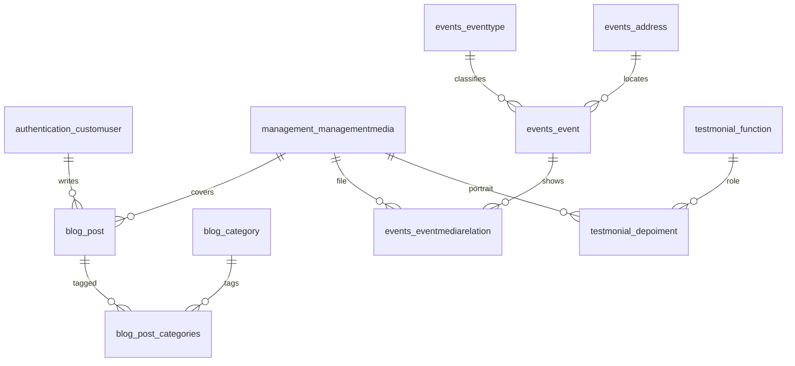

# Legacy database

> [!note] Map, not the new schema
> Home and about rows existed so editors could change page copy. That copy moves into the Next.js app. Do not recreate those tables unless a later decision says a field must stay editable.

Source: the Django models in `bkp-repos/ong-gabriel-backend-main`. Table names are Django defaults, `{app}_{model}`. The testimonials app is spelled `testmonial` in the old code, and the table names keep that spelling.

There is no comments table. Comments are a new feature: [[comments]].

Primary keys are UUIDs. Foreign keys are `{field}_id`. Timestamps are `created_at` and `updated_at` unless noted.

## Domain tables

These are the records the new API is likely to own.

| Table | Was | Relations |
| --- | --- | --- |
| `authentication_customuser` | Editor account. Email is the login. Also stores `username`, `cpf`, and `is_active`. | Django M2M tables `authentication_customuser_groups` and `authentication_customuser_user_permissions`. |
| `blog_category` | Post category. `name` is stored lowercase. | M2M with posts. |
| `blog_post` | Blog post. `slug` is `{author}/{title}`. Unique on `(author_id, title)`. | `author_id` → user, null on user delete. `media_id` → media, null on media delete. |
| `blog_post_categories` | M2M between post and category. | `post_id`, `category_id`. |
| `events_eventtype` | Event type. `name` is stored lowercase. | Referenced by events. |
| `events_address` | Physical address, plus an optional Google Maps URL. | Referenced by events. |
| `events_event` | Event. Has start datetime, optional end time, short description, body, and optional online URL. | `type_id` and `address_id` are optional. Media goes through the link table. |
| `events_eventmediarelation` | Event ↔ media, with one `is_cover` per event. Unique on `(event_id, media_id)`. | Both FKs cascade. |
| `testmonial_function` | Role label for a testimonial author. | Testimonials protect this row: it cannot be deleted while referenced. |
| `testmonial_depoiment` | Testimonial: name, message, role, image. | `function_id` is required. `image_id` → media, null on media delete. |
| `management_managementmedia` | Uploaded image or video. File path `management/{slug}-{id}{ext}`. Unique `slug`. | Shared by posts, events, testimonials, and the CMS sections below. |

`authentication_customuser` extends Django's user, so a real database also has `auth_group`, `auth_permission`, `django_content_type`, `django_session`, `django_admin_log`, and `django_migrations`. Those are framework tables.

## CMS tables

Each section table was limited in `save()` to one row, except the card tables, which allowed a fixed count. Editors changed them from the Django admin and from `/v1/cms/...`. None of these are a target table.

Home (`management_` prefix):

| Table | Rows | Points at |
| --- | --- | --- |
| `management_presentationsection` | 1 | `image_id` → media |
| `management_missionsection` | 1 | text only |
| `management_donatesection` | 1 | text only |
| `management_statscard` | 4, `card_number` unique | text and a number |
| `management_volunteersection` | 1 | `image_id` → media |
| `management_depoimentcard` | 3, `card_number` unique | `depoiment_id` → `testmonial_depoiment` |
| `management_activitycard` | 3, `card_number` unique | `image_id` → media |
| `management_contactsection` | 1 | email and social URLs, each with a visibility flag |
| `management_tributesection` | 1 | `left_image_id` and `right_image_id` → media |

About (`management_` prefix):

| Table | Rows | Points at |
| --- | --- | --- |
| `management_abouthistorysection` | 1 | `card_media_id` and `background_image_id` → media |
| `management_aboutmissionsection` | 1 | `media_id` → media |
| `management_aboutvaluecards` | 7, `card_number` unique | text only |
| `management_aboutidealizerssection` | 1 | `media_id` → media. The body column is misspelled `descrption`. |
| `management_aboutcarouselsection` | 1 | M2M `management_aboutcarouselsection_medias` → media |

`management_depoimentcard` is the only CMS table that depends on a domain row. The testimonial itself can stay dynamic. The three home slots do not need a table once the home page is static.
